# Adaptive SYN Cookie-Based Mitigation of DDoS Attacks

A simulated case study of a SYN flood attack and an adaptive defense against it,
modeled on a campus exam-results portal. Built for **Computer Networks (BACSE203)**.

Everything here runs inside an isolated [Mininet](http://mininet.org/) virtual
network on your own machine. **Nothing in this repository is intended to be
pointed at any real host, domain, or production system** — all traffic stays
within the lab's own `10.0.0.0/8` subnet.

## What this is

A small virtual network — one exam-portal server, two legitimate student
hosts, and one attacker host — used to:

1. Demonstrate a TCP SYN flood attack with real packet-level evidence (Wireshark).
2. Detect it using an EWMA-tracked SYN rate combined with Rényi entropy of
   source IP addresses, so a genuine traffic rush (many real requests from
   one host) isn't mistaken for a spoofed flood (many requests from randomized
   source IPs).
3. Mitigate it with an adaptive version of TCP's SYN cookie mechanism —
   HMAC-SHA256 with per-connection nonces for replay resistance, and a
   secret-key rotation interval that shortens automatically the instant
   the detector confirms an attack.

All of the screenshots below are from an actual run of this project on a
live Mininet testbed — not mockups.

## Requirements

- Linux (native, or WSL2 on Windows — see notes below)
- [Mininet](http://mininet.org/download/)
- Python 3.8+
- [Scapy](https://scapy.net/)
- Wireshark (for inspecting `.pcap` captures — can run on the host OS)

Install Python dependencies:

```bash
pip install -r requirements.txt
```

On Windows, install [WSL2](https://learn.microsoft.com/en-us/windows/wsl/install)
with an Ubuntu distribution, then install Mininet and Scapy inside it:

```bash
sudo apt update
sudo apt install mininet python3-pip -y
pip3 install -r requirements.txt
```

Wireshark itself should be installed natively on Windows (not inside WSL);
`.pcap` files written inside WSL are reachable from Windows at
`\\wsl$\<distro-name>\home\<user>\...`.

## Project structure

```
.
├── src/
│   ├── topology.py            # builds the Mininet network
│   ├── server.py               # simulated exam-results portal (TCP server)
│   ├── client_normal.py        # one legitimate student, occasional requests
│   ├── client_rush.py          # genuine mass rush from ONE bounded host
│   ├── attack_synflood.py      # Scapy-based SYN flood (lab subnet only)
│   ├── ewma_detector.py        # EWMA + Rényi entropy detector, closed-loop
│   └── adaptive_syn_cookie.py  # adaptive, replay-resistant SYN cookie logic
├── scripts/
│   └── capture_helper.sh       # labeled tcpdump capture helper
├── assets/
│   └── screenshots/            # evidence from an actual test run
├── requirements.txt
└── README.md
```

## Running it

All commands below are run **inside the Mininet CLI** (`mininet>` prompt),
after starting the topology:

```bash
cd src
sudo mn -c                 # clear any leftover Mininet state
sudo python3 topology.py   # launches the topology, drops you into mininet>
```

Mininet reports clean connectivity across all four hosts before anything
else runs:

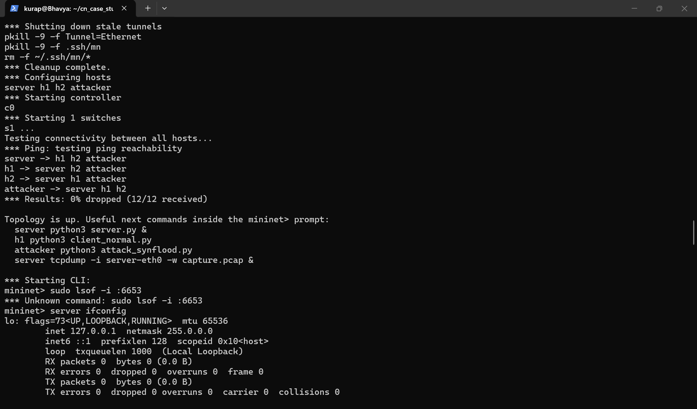

Inside `mininet>`, get the server's IP first:

```
server ifconfig
```

(Usually `10.0.0.1` — adjust the commands below if yours differs.) `dump`
and `net` confirm the topology's actual links:

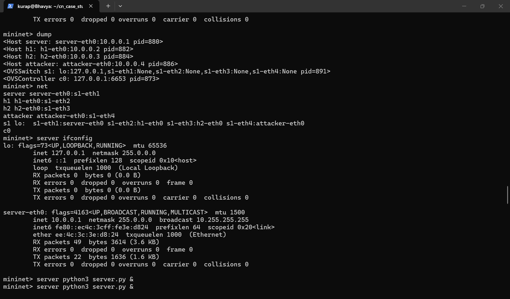

### 1. Baseline (normal traffic)

```
server python3 server.py &
h1 python3 client_normal.py
```

All 20 requests succeed cleanly against the idle server:

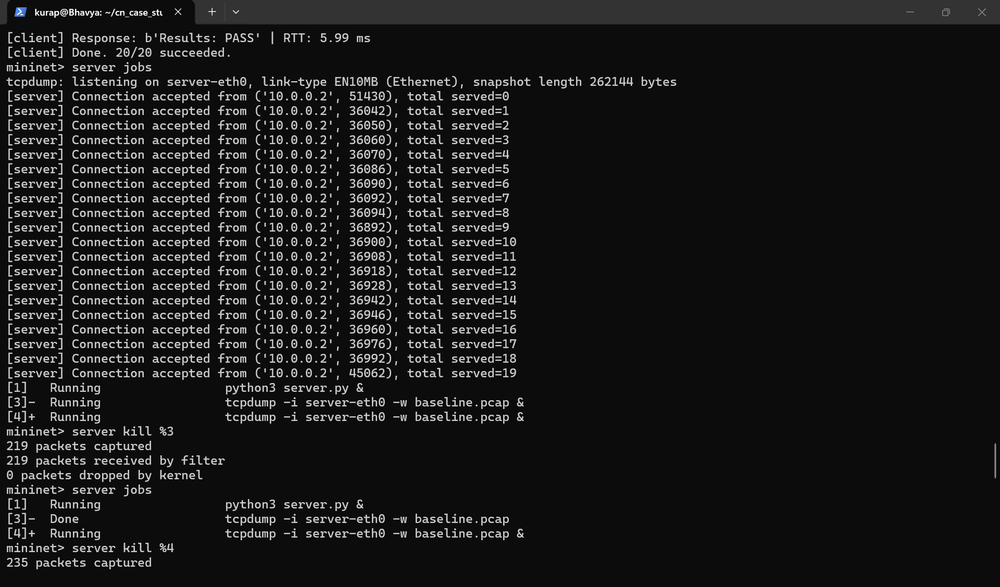

The corresponding Wireshark capture (`tcp.port == 8080`) shows a complete,
standard TCP three-way handshake — SYN, SYN-ACK, ACK:

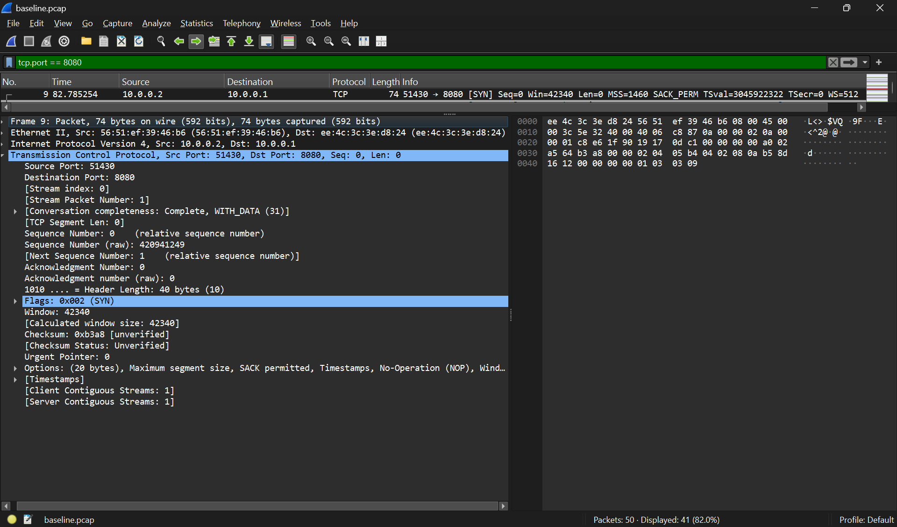

### 2. Unmitigated attack

```
server python3 server.py &
attacker python3 attack_synflood.py 10.0.0.1
h1 python3 client_normal.py
```

The flood sends 2000 SYN packets with randomized source IPs:

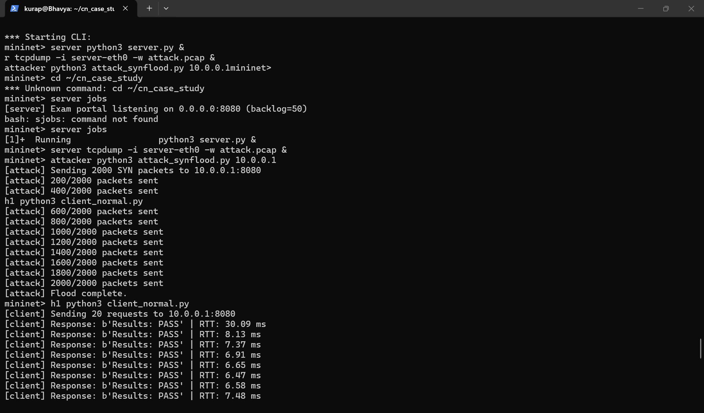

Filtered in Wireshark (`tcp.flags.syn==1 && tcp.flags.ack==0`), 2,020 of
8,221 captured packets are unanswered SYNs from randomized sources — the
server's backlog being targeted directly:

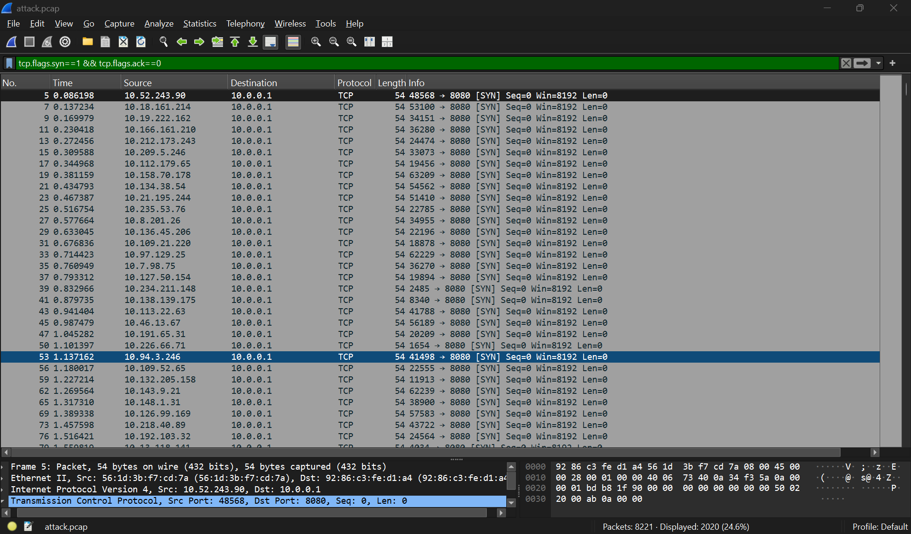

### 3. Defended (detector + adaptive cookie active)

```
server python3 server.py &
server python3 ewma_detector.py &
attacker python3 attack_synflood.py 10.0.0.1
h1 python3 client_normal.py
```

The detector's anomaly counter climbs across three windows, confirms the
attack, and calls directly into the cookie module in the same instant —
the closed loop this project is built around:

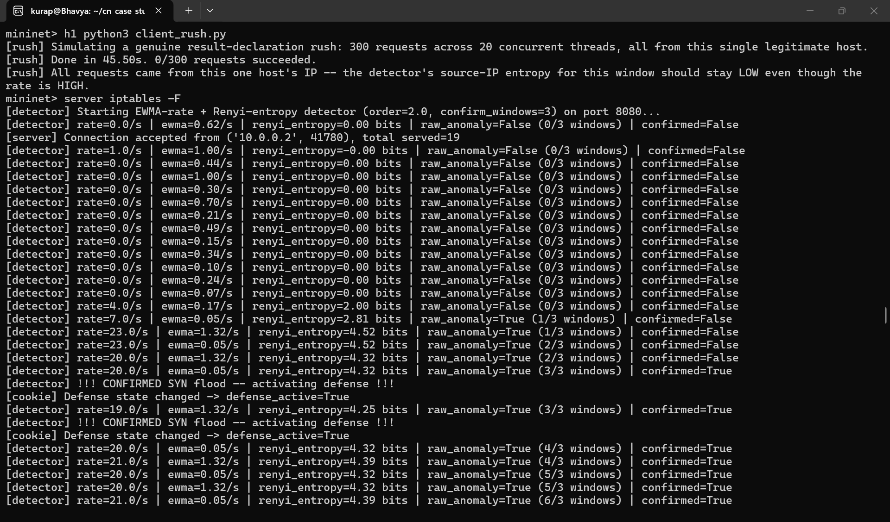

Detection stays engaged for as long as the flood continues:

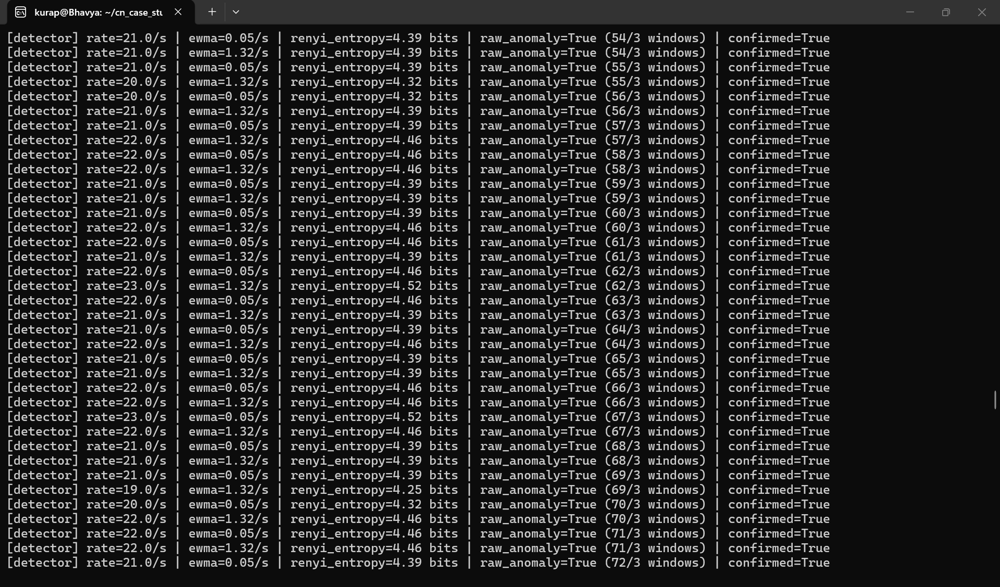

Once the flood stops, the detector notices within a single window and
relaxes the defense, clearing its `iptables` rules:

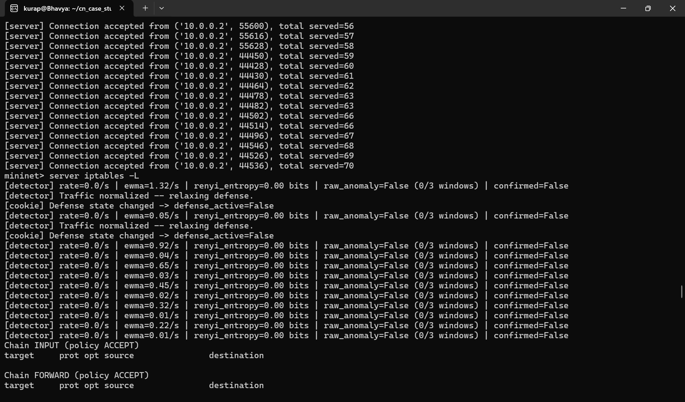

### 4. Genuine rush (false-positive check, no attacker)

```
server python3 ewma_detector.py &
h1 python3 client_rush.py
```

300 rapid requests from one legitimate host — 255 succeed in ~9 seconds:

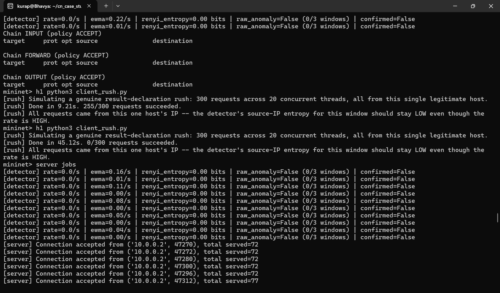

The rate climbs to 60–70 req/s, but Rényi entropy of the source IPs stays
at 0.00 bits the whole time, since it's genuinely all one host — so the
detector correctly does **not** trigger the defense:

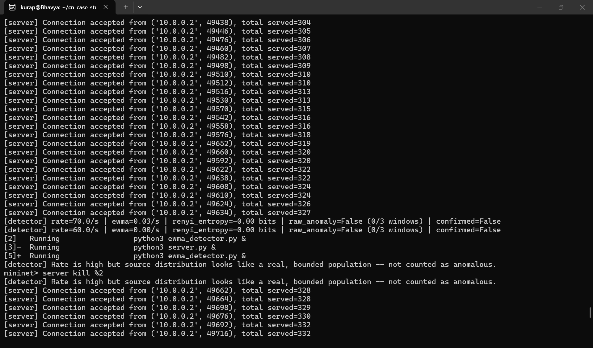

This is the actual evidence that the system tells a real traffic spike
apart from a spoofed one, instead of just reacting to volume.

### 5. Cookie algorithm demo (standalone, no Mininet needed)

```bash
python3 src/adaptive_syn_cookie.py
```

Shows cookie generation/verification for both normal and attack states,
and a replayed cookie being explicitly rejected:

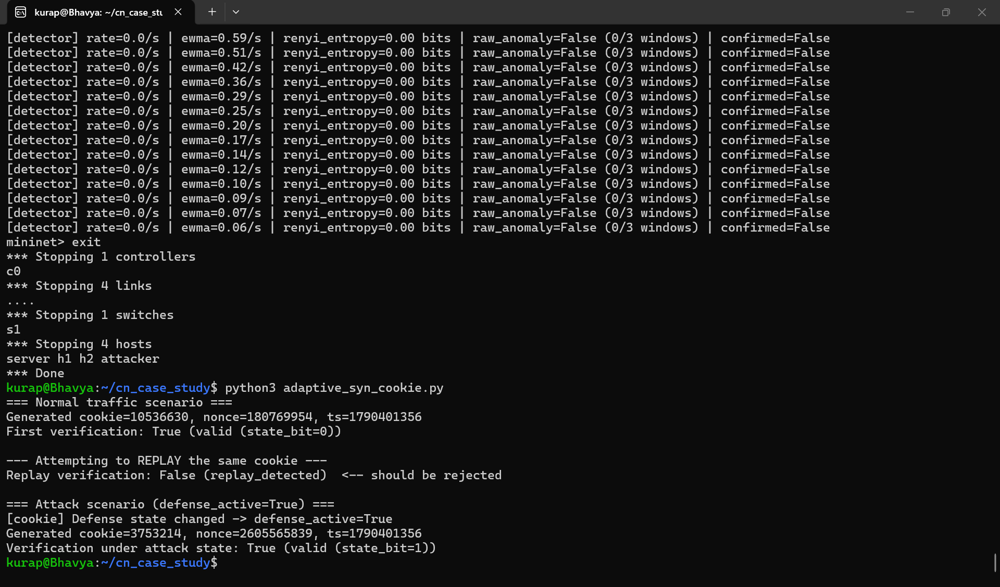

### Capturing traffic

From the `server` host, in a separate background job:

```
server tcpdump -i server-eth0 -w baseline.pcap &
```

or use the helper script for consistently named captures:

```
server bash scripts/capture_helper.sh baseline
```

Pull the resulting `.pcap` onto your host OS and open it in Wireshark to
inspect the handshake (`tcp.port == 8080`) or isolate flood traffic
(`tcp.flags.syn==1 && tcp.flags.ack==0`).

## Known limitations

- `adaptive_syn_cookie.py` is a standalone demonstration of the algorithm —
  it does not patch or replace the Linux kernel's real TCP stack.
- The server's connection backlog (50) can remain saturated for a short
  period even after the defense activates, since already-queued half-open
  connections take time to clear. This is a genuine, observed limitation,
  not a detection failure — see the project report for details.
- The detection statistics (EWMA, Rényi entropy) are adopted from existing
  research rather than novel to this project; the contribution here is the
  closed-loop integration between detection and the cookie mechanism itself.

## Safety

This project is self-contained. Do not modify these scripts to target any
host, domain, or IP address outside your own Mininet topology.

## License

MIT — see [LICENSE](LICENSE).
